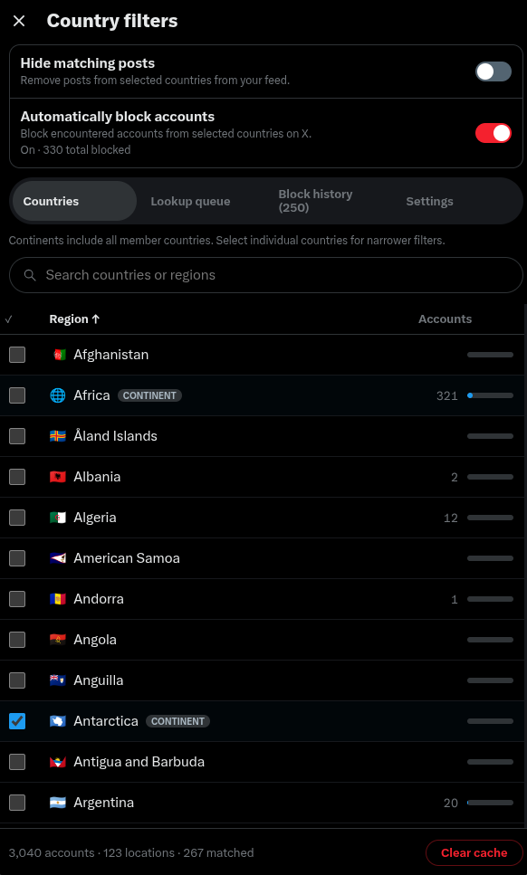

# LocaleFence - Country Filter for X

LocaleFence shows the country from X's **About this account** data beside accounts in the feed. You can use that context to hide matching posts or, after an explicit confirmation, automatically block matching accounts.

It is local-first: there is no LocaleFence server, analytics, or external data service.

> Automatic blocking creates real blocks on your X account. Review the selected locations before enabling it. X's country label can be missing or inaccurate and is not proof of a person's nationality or current physical location.

**[Install LocaleFence for X from Greasy Fork](https://greasyfork.org/en/scripts/585483-localefence-for-x)**

<p align="center">
  
</p>

## Features

- Show a country flag beside encountered X accounts.
- Optionally match the app-store country from X's **Connected via** data (off by default), for hiding and automatic blocking when the reported location does not match.
- Show X's **Connected via** label in the flag tooltip and mark its "location may not be accurate" warning beside the flag, even when the reported country is missing.
- Select individual countries, X regions, or whole continents.
- Hide matching posts without blocking their authors.
- Optionally block matching accounts as their posts appear.
- Show the account, flag, and triggering post in corner-positioned block notifications, compact by default and placed below X's search bar.
- Exclude and immediately unblock an account from its notification or block-history entry.
- Keep lookups that cannot proceed in a persistent, inspectable queue with rate-limit backoff.
- Keep up to 250 confirmed block-history entries and their triggering post snapshots locally.
- Cache successful location lookups for 28 days, share the 64 most recent results across open X tabs, and briefly remember unavailable profiles to avoid wasted requests.
- Recover from X `AboutAccountQuery` identifier changes using observed same-origin requests and a current fallback.
- Revalidate the current username, account ID, and location immediately before every automatic block.
- Serialize block requests across open X tabs and remember confirmed blocks per signed-in X account.
- Reset all locally stored LocaleFence data from Settings.

## Install the userscript

1. Install a userscript manager such as Tampermonkey or Violentmonkey.
2. Open **[LocaleFence on Greasy Fork](https://greasyfork.org/en/scripts/585483-localefence-for-x)** and confirm the installation.
3. Open or reload [x.com](https://x.com/).

LocaleFence adds an item to X's desktop sidebar and mobile side drawer. The entry appears when X builds its navigation. The settings panel is full-screen on narrow displays and opens when you select the entry.

The userscript keeps its original metadata name, **LocaleFence for X**, so existing Greasy Fork installations continue to be recognized as the same script. The browser-extension title is **LocaleFence - Country Filter for X**.

## Try the browser extensions

The repository now builds minimal Manifest V3 packages for Chromium and Firefox. Until signed store releases are available, build them locally:

```sh
npm ci
npm test
npm run build:extension
```

Open `chrome://extensions`, enable **Developer mode**, choose **Load unpacked**, and select `dist/localefence-chromium`.

The Firefox build is in `dist/localefence-firefox`. Test it on desktop with `web-ext run` or follow the Android steps below before AMO submission.

Do not run both distributions at once. LocaleFence detects this situation and allows only the first copy to start, but uninstalling or disabling the redundant copy avoids update-order surprises.

## Test Firefox for Android

1. Install an up-to-date Firefox for Android on the phone.
2. Enable Android **Developer options** and **USB debugging**, connect the phone to this computer, and approve the debugging prompt.
3. Confirm that ADB can see it:

   ```sh
   adb devices -l
   ```

4. Build the current Firefox package:

   ```sh
   npm run build:extension
   ```

5. Keep at least one Firefox tab open, then temporarily install LocaleFence. Replace `DEVICE_SERIAL` with the value reported by ADB:

   ```sh
   npx --yes web-ext@latest run \
     --source-dir dist/localefence-firefox \
     --target firefox-android \
     --android-device DEVICE_SERIAL \
     --firefox-apk org.mozilla.firefox
   ```

   Use `org.mozilla.firefox_beta` for Firefox Beta or `org.mozilla.fenix` for Firefox Nightly.

6. In Firefox on the phone, sign in at `x.com`, reload the page, and open LocaleFence from X's navigation. Test flags and hiding before enabling automatic blocking.
7. Keep the terminal command running during the test. Press **Ctrl+C** when finished; this is a temporary development installation.

For debugging, connect Firefox Desktop through `about:debugging`, select the Android device, and inspect its main process or the `x.com` tab.

## Use

1. Open **LocaleFence** and select the locations to match.
2. Enable **Hide matching posts**, **Automatically block accounts**, or both.
3. Use **Lookup queue** to inspect unresolved or failed checks. Removing an item cancels its block if the request has not started.
4. Use **Block history** to review confirmed actions and open their triggering posts.
5. Use **Settings** to enable notifications, choose their size and screen corner, match accounts by X's Connected-via store region, inspect X's last reported lookup quota, or erase all LocaleFence data.

**Match Connected via store region** is off by default. When enabled, an account also matches when the app-store country in X's **Connected via** data is selected, even if the account's reported location is not. It applies to hiding and to automatic blocking, which still re-checks the account immediately before asking X to block it. Only recognized country-and-store labels count as store matches. The store region can be stale or belong to another country for reasons unrelated to location, so review it before enabling it for blocking.

The flag tooltip shows the Connected-via label whenever X supplies it. A warning marker shows when X reports that the location may be inaccurate; that warning alone never hides or blocks anyone. If only the store country is available, its flag carries a **store** label. Accounts with a warning but no country show a globe and the warning marker. Cached records from older versions refresh on encounter to fetch this metadata.

Country counts include store regions when matching is enabled. Each account counts once in the total, once per matching country, and once per continent. An account with two different countries can appear in both country rows.

Automatic blocking remains enabled across X reloads until you turn it off. If a block request fails or times out, LocaleFence keeps the safety pause across reloads; turn blocking off and on only when you deliberately want to retry. Adding a location while blocking is active also requires confirmation because matching accounts already in the feed may be processed immediately.

Selecting a continent includes all of its member countries. Individual countries can be selected independently. Continent membership follows the [UN M49 geographic classification](https://unstats.un.org/unsd/methodology/m49/overview/).

Under normal quota, location checks and confirmed block actions proceed immediately without a fixed or adaptive pacing delay. Location checks use the same read-only POST transport as LocaleFence 1.1.0, with GET retained as a compatibility fallback only if X rejects POST. Terminal unavailable-profile results are remembered for one hour instead of being requested repeatedly, and a waiting tab reuses another tab's newly completed lookup when doing so does not weaken block identity verification. When X actually rate-limits a lookup, LocaleFence retains the account and post snapshot, honors X's `Retry-After` and quota-reset headers for up to seven days, and persists one shared cooldown across reloads and open X tabs. A server-provided reset is used as the scheduled retry time with a one-second safety margin; if X omits both headers, LocaleFence starts with a 15-second estimate and doubles repeated headerless waits up to one hour instead of polling X continuously. Lookups resume only while X is visible. A non-matching account leaves the queue after resolution. A matching account remains until X confirms the block, then moves to block history.

Cached location data may be used to hide posts. It is never trusted as username-to-account proof for blocking: LocaleFence performs a fresh identity lookup immediately before the request.

## Browser and Android direction

- **Chrome, Edge, and other Chromium desktop browsers:** use the Manifest V3 package; Chrome Web Store publication is the next distribution milestone.
- **Android:** Chrome for Android cannot install extensions. The planned supported route is the same WebExtension published for Firefox for Android. It will work on `x.com` in Firefox, not inside the native X app.

## Data and privacy

LocaleFence reads only the X page content needed for its visible features and sends requests only to `x.com` using the active X session. It does not use an external server.

It stores the following in browser storage associated with `x.com`:

- selected locations, settings, exclusions, counters, pause state, remembered owner/account block IDs, quota telemetry, and a small cross-tab lookup cache in `localStorage`;
- resolved account IDs, names, locations, the Connected-via store label and its country, X's location-accuracy flag, and cache timestamps in IndexedDB;
- pending lookup records and up to 250 confirmed block-history entries in IndexedDB, including whether each block matched the reported country or the store region.

The individual clear controls remove their named datasets. **Settings → Reset LocaleFence** removes all LocaleFence browser data but does not undo blocks already held by X. Uninstalling the extension alone may leave `x.com` site data, so use Reset or clear X site data when complete deletion is wanted.

See the full [privacy policy](PRIVACY.md).

## Limitations

- X account locations may be missing, broad, stale, or inaccurate.
- The Connected-via store region can lag behind or differ from where an account currently connects, for example after a move or for accounts managed from several countries. X's location warning reports possible inaccuracy; it does not establish VPN or proxy use, and LocaleFence never hides or blocks on that warning alone.
- Each previously unseen account requires an X About Account request. X does not publish the private endpoint's exact allowance, so long sessions can exhaust it even though LocaleFence caches and deduplicates results; queued checks resume after X's reported reset.
- X's private web APIs can change without notice. LocaleFence can recover from query-identifier rotation, but schema or action-endpoint changes can still break features temporarily.
- A timed-out action has an unknown server result, so automatic blocking pauses for review.
- Excluding an account requires a successful X unblock request to undo an existing block.
- Blocks changed outside LocaleFence are not detected; remembered IDs remain until LocaleFence unblocks the account or local data is reset.
- Browser tools cannot modify the native X Android app.

## Development

The project has no runtime dependencies. Its persistence tests use `fake-indexeddb` as a development dependency. Install the development dependencies and run the safety, persistence, and extension-metadata checks with:

```sh
npm ci
npm test
```

Build the unpacked Chromium release directory with:

```sh
npm run build:extension
```

## License

[GNU General Public License v3.0 only](LICENSE). This software is provided without warranty.
